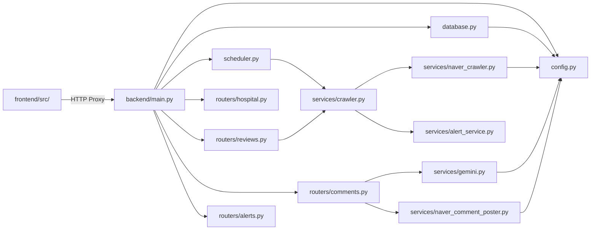
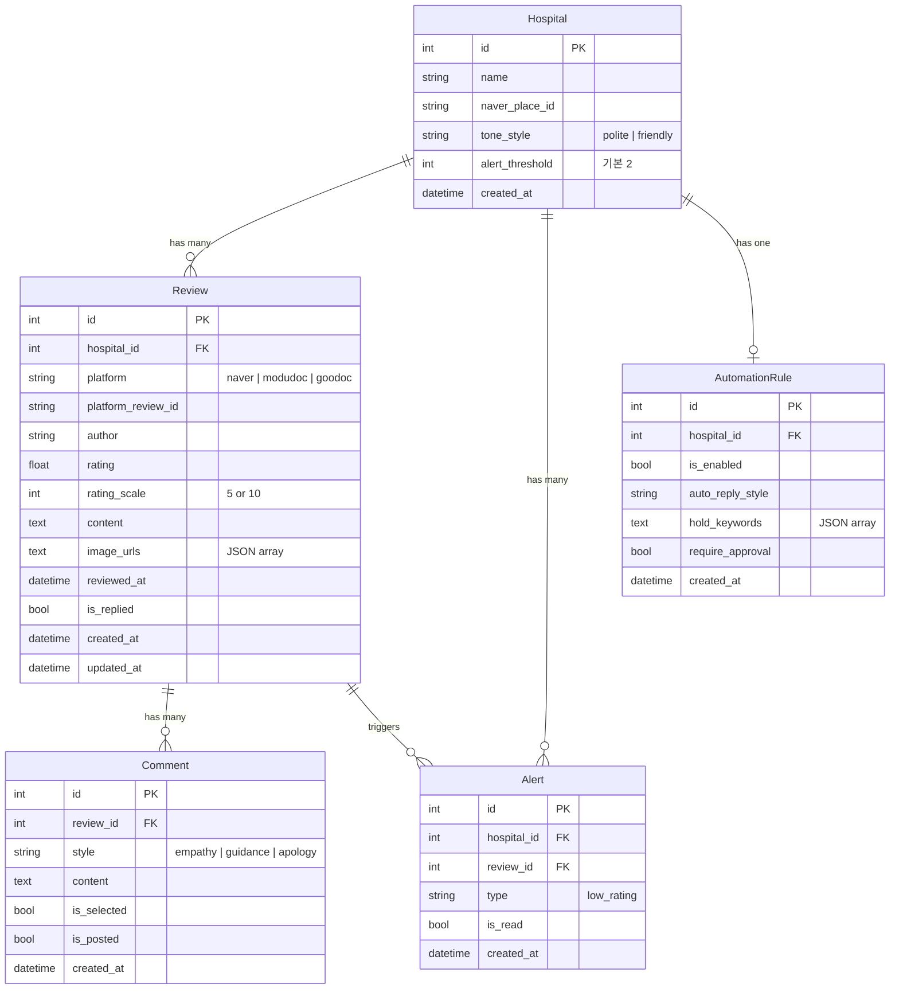

# MediReview — Source Structure & Function Reference

> 마지막 검증: 2026-03-03T21:00Z
> Backend: FastAPI + SQLAlchemy · 11 Python 파일 · ~1,040L total
> Frontend: React 19 + Vite + Tailwind CSS · 14 JSX/JS 파일 · ~29,000 bytes
> DB: SQLite (MVP) → PostgreSQL (확장 시)
> AI: Google Gemini 2.0 Flash
> 크롤링: Selenium + BeautifulSoup (네이버 지도)
>
> 상세 모듈 문서는 [서브 문서](#서브-문서)를 참조하세요.

---

## File Tree

```text
medireview/
├── PROPOSAL.md               ← 기획서: 서비스 개요 + 문제 정의 + 핵심 기능 + 수익 모델 (97L)
├── BLUEPRINT.md              ← 블루프린트: 기술 스택 + 데이터 모델 + API 설계 + 개발 단계 (380L)
├── .gitignore                ← Git 무시 규칙 (620B)
├── backend/                  ← FastAPI 백엔드
│   ├── main.py               ← FastAPI 앱 진입점 + CORS + lifespan(테이블 생성 + 스케줄러) (46L)
│   ├── config.py             ← pydantic-settings 환경 설정 + .env 로드 (18L)
│   ├── database.py           ← SQLAlchemy 엔진 + SessionLocal + get_db() (23L)
│   ├── models.py             ← ORM 모델 5개: Hospital, Review, Comment, Alert, AutomationRule (95L)
│   ├── schemas.py            ← Pydantic 스키마 15개 + ReviewStats + PaginatedReviews (135L)
│   ├── scheduler.py          ← APScheduler 주기적 리뷰 수집 잡 (49L)
│   ├── seed.py               ← 더미 데이터 시드 스크립트: 병원 1개 + 리뷰 50건 (119L)
│   ├── test_crawler.py       ← 크롤러 수동 테스트 (생략)
│   ├── requirements.txt      ← Python 의존성 (241B)
│   ├── .env                  ← 환경변수 (비공개)
│   ├── routers/              ← FastAPI API 라우터
│   │   ├── __init__.py
│   │   ├── hospital.py       ← 병원 CRUD: GET/POST/PUT /api/hospital (54L)
│   │   ├── reviews.py        ← 리뷰 목록+상세+통계+동기화: /api/reviews/* (118L)
│   │   ├── comments.py       ← AI 댓글 생성+조회+등록: /api/reviews/{id}/comments (108L)
│   │   └── alerts.py         ← 알림 목록+읽음+미읽음 수: /api/alerts/* (43L)
│   └── services/             ← 비즈니스 로직
│       ├── __init__.py
│       ├── gemini.py         ← Gemini API 연동: 리뷰→3종 댓글 JSON 생성 (102L)
│       ├── crawler.py        ← 통합 크롤링 오케스트레이터: _save_reviews + sync_all (83L)
│       ├── naver_crawler.py  ← 네이버 지도 Selenium 크롤러: fetch_naver_reviews (213L)
│       ├── naver_comment_poster.py ← 네이버 댓글 자동 등록: 로그인→매칭→답글 (225L)
│       └── alert_service.py  ← 저평점 알림 자동 생성: check_and_create_alert (56L)
├── frontend/                 ← React + Vite 프론트엔드
│   ├── package.json          ← React 19, Vite, Tailwind, axios, react-router-dom
│   ├── vite.config.js        ← Vite 설정 + API 프록시 (→ localhost:8000)
│   ├── index.html            ← 진입점 HTML (357B)
│   ├── src/
│   │   ├── main.jsx          ← ReactDOM.createRoot 진입점 (230B)
│   │   ├── App.jsx           ← BrowserRouter + 5개 라우트 (24L)
│   │   ├── index.css         ← Tailwind @import (23B)
│   │   ├── api/
│   │   │   └── client.js     ← Axios 래퍼: Hospital/Reviews/Comments/Alerts/Automation (38L)
│   │   ├── components/       ← 재사용 컴포넌트
│   │   │   ├── Layout.jsx    ← 네비게이션 바 + Outlet + 알림 배지 (2.2KB)
│   │   │   ├── ReviewCard.jsx ← 리뷰 카드 (별점+플랫폼+미답변 배지) (1.5KB)
│   │   │   ├── FilterBar.jsx ← 필터 UI (플랫폼/별점/답변여부/정렬) (2.6KB)
│   │   │   ├── StarRating.jsx ← 별점 렌더링 (★☆) (760B)
│   │   │   ├── PlatformBadge.jsx ← 플랫폼 컬러 배지 (540B)
│   │   │   └── AlertBadge.jsx ← 미읽음 알림 수 배지 (529B)
│   │   ├── pages/            ← 페이지 컴포넌트
│   │   │   ├── Dashboard.jsx ← 리뷰 대시보드: 통계 카드 + 필터 + 페이지네이션 (6.6KB)
│   │   │   ├── ReviewDetail.jsx ← 리뷰 상세 + AI 댓글 생성/선택/등록 (7.4KB)
│   │   │   ├── Alerts.jsx    ← 알림 목록 + 읽음 처리 + 리뷰 링크 (4.0KB)
│   │   │   ├── Settings.jsx  ← 병원 설정 (톤앤매너, 알림 기준, Place ID) (5.4KB)
│   │   │   └── AutomationSettings.jsx ← 자동화 설정 (플레이스홀더) (286B)
│   │   └── hooks/            ← (빈 디렉토리, 향후 커스텀 훅)
│   └── public/
│       └── vite.svg
├── tmp/                      ← 임시 파일
└── devlog/                   ← 개발 기록
    ├── _fin/                 ← 완료된 개발 기록
    ├── _plan/                ← 미착수/진행 중 계획
    └── str_func/             ← 코드 구조 + 함수 레퍼런스
```

---

## 코드 구조 개요



### 의존 관계 규칙

| 계층           | 의존 대상                           | 비고                             |
| -------------- | ----------------------------------- | -------------------------------- |
| `config.py`    | —                                   | 의존 0, pydantic-settings + .env |
| `database.py`  | config                              | SQLAlchemy 엔진, SessionLocal    |
| `models.py`    | database                            | ORM 5 모델, Base 상속            |
| `schemas.py`   | —                                   | Pydantic only (의존 0)           |
| `routers/*`    | database, models, schemas, services | HTTP 엔드포인트                  |
| `services/*`   | config, models (간접)               | 비즈니스 로직 계층               |
| `scheduler.py` | config, database, services/crawler  | 크론 잡                          |
| `main.py`      | 전체                                | 글루 레이어                      |
| `frontend/`    | backend (HTTP proxy via Vite)       | React SPA, 독립 빌드             |

---

## 데이터 모델 (models.py — 95L)



### DB 파일

| 경로                    | 설명                 |
| ----------------------- | -------------------- |
| `backend/medireview.db` | SQLite DB (MVP)      |
| `backend/.env`          | 환경변수 (API 키 등) |

### 주요 의존성

```
fastapi · uvicorn · sqlalchemy · pydantic · pydantic-settings
google-generativeai · apscheduler · selenium · webdriver-manager
beautifulsoup4 · lxml
```

---

## Backend 상세

### config.py — 환경 설정 (18L)

| 필드                    | 기본값                      | 설명                   |
| ----------------------- | --------------------------- | ---------------------- |
| `DATABASE_URL`          | `sqlite:///./medireview.db` | DB 연결 문자열         |
| `GEMINI_API_KEY`        | `""`                        | Google Gemini API 키   |
| `SYNC_INTERVAL_MINUTES` | `5`                         | 크롤링 주기 (분)       |
| `NAVER_PLACE_ID`        | `""`                        | 네이버 지도 Place ID   |
| `CHROME_HEADLESS`       | `True`                      | Selenium headless 모드 |
| `NAVER_ID`              | `""`                        | 네이버 로그인 ID       |
| `NAVER_PW`              | `""`                        | 네이버 로그인 PW       |

---

### database.py — DB 연결 (23L)

| Export         | 역할                               |
| -------------- | ---------------------------------- |
| `engine`       | SQLAlchemy 엔진 (SQLite 전용 옵션) |
| `SessionLocal` | 세션 팩토리                        |
| `Base`         | declarative_base (모든 모델 상속)  |
| `get_db()`     | FastAPI Depends용 세션 제너레이터  |

---

### main.py — 앱 진입점 (46L)

| 항목       | 내용                                  |
| ---------- | ------------------------------------- |
| lifespan   | 테이블 자동 생성 + 스케줄러 시작/종료 |
| CORS       | `http://localhost:5173` 허용          |
| 라우터 4개 | hospital, reviews, comments, alerts   |
| 헬스체크   | `GET /api/health → {"status": "ok"}`  |

---

### routers/ — API 엔드포인트 (4 파일, 323L)

#### hospital.py (54L) — 병원 CRUD

| Method | Endpoint        | 함수              | 설명                            |
| ------ | --------------- | ----------------- | ------------------------------- |
| GET    | `/api/hospital` | `get_hospital`    | 병원 정보 조회 (MVP: 단일)      |
| POST   | `/api/hospital` | `create_hospital` | 최초 등록 + AutomationRule 생성 |
| PUT    | `/api/hospital` | `update_hospital` | 정보 수정 (partial update)      |

#### reviews.py (118L) — 리뷰 관리

| Method | Endpoint             | 함수           | 설명                                                        |
| ------ | -------------------- | -------------- | ----------------------------------------------------------- |
| GET    | `/api/reviews`       | `list_reviews` | 목록 (필터: platform, rating, replied, sort) + 페이지네이션 |
| GET    | `/api/reviews/stats` | `review_stats` | 통계: 총 수, 평균 별점, 미답변 수, 플랫폼별, 별점 분포      |
| GET    | `/api/reviews/{id}`  | `get_review`   | 상세 조회                                                   |
| POST   | `/api/reviews/sync`  | `sync_reviews` | 수동 동기화 트리거 → crawler.sync_all                       |

**핵심 주의점**:
- `list_reviews` 정렬: `latest|oldest|rating_high|rating_low` 4가지
- `review_stats`: 별점 분포에서 빈 별점(1~5)도 `setdefault`로 채움
- `sync_reviews`에서 `services.crawler` 지연 import (순환 방지)

#### comments.py (108L) — AI 댓글

| Method | Endpoint                              | 함수                    | 설명                                       |
| ------ | ------------------------------------- | ----------------------- | ------------------------------------------ |
| POST   | `/api/reviews/{id}/generate-comments` | `api_generate_comments` | Gemini 댓글 3종 생성 (기존 삭제 후 재생성) |
| GET    | `/api/reviews/{id}/comments`          | `get_comments`          | 리뷰별 댓글 목록                           |
| POST   | `/api/reviews/{id}/post-comment`      | `post_comment`          | 선택 댓글 → 네이버 자동 등록               |

**핵심 주의점**:
- `generate-comments`: 기존 댓글 **전체 삭제 후** 재생성 (idempotent 아님)
- `post-comment`: `naver_comment_poster.post_reply_to_naver()` 호출 → Selenium 자동화
- `hospital.naver_place_id` 미설정 시 400 에러

#### alerts.py (43L) — 알림

| Method | Endpoint                   | 함수           | 설명           |
| ------ | -------------------------- | -------------- | -------------- |
| GET    | `/api/alerts`              | `list_alerts`  | 최신 100건     |
| PATCH  | `/api/alerts/{id}/read`    | `mark_read`    | 읽음 처리      |
| GET    | `/api/alerts/unread-count` | `unread_count` | 미읽음 알림 수 |

---

### services/ — 비즈니스 로직 (5 파일, 679L)

#### gemini.py (102L) — AI 댓글 생성

| 함수                  | 역할                                     |
| --------------------- | ---------------------------------------- |
| `generate_comments()` | 리뷰→Gemini 호출→3종 댓글 JSON 파싱+검증 |

**핵심 주의점**:
- 모델: `gemini-2.0-flash` (경량 고속)
- 시스템 프롬프트: 한국어, 100~200자, 3 스타일(empathy/guidance/apology)
- JSON 파싱: 마크다운 코드블록(```) 자동 제거
- 유효성: `valid_styles` 체크, 3개 미만이면 warn 로그
- 실패 시 빈 리스트 반환 (500 에러는 라우터에서 처리)

#### crawler.py (83L) — 통합 크롤링 오케스트레이터

| 함수                   | 역할                                   |
| ---------------------- | -------------------------------------- |
| `_save_reviews()`      | 크롤링 결과 DB 저장 + 중복 체크 + 알림 |
| `sync_naver_reviews()` | 네이버 크롤러 호출 + DB 저장           |
| `sync_all_reviews()`   | 모든 플랫폼 동기화 (MVP: 네이버만)     |

**핵심 주의점**:
- `platform_review_id` 기반 중복 제거
- `flush()` 후 `check_and_create_alert()` 호출 (ID 할당 필요)
- MVP에서는 네이버만 활성, 모두닥/굿닥은 주석 처리

#### naver_crawler.py (213L) — 네이버 지도 크롤러

| 함수                    | 역할                                          |
| ----------------------- | --------------------------------------------- |
| `_create_driver()`      | Chrome WebDriver 생성 (headless 옵션)         |
| `_parse_date(date_str)` | 4개 형식 날짜 파싱 (절대/상대/단축)           |
| `_generate_review_id()` | author+content+date MD5 해시 → 고유 ID        |
| `fetch_naver_reviews()` | Selenium 크롤링: 페이지 로드→더보기→HTML 파싱 |

**핵심 주의점**:
- CSS 셀렉터 `li.place_apply_pui.EjjAW` → 네이버 UI 변경 시 깨질 수 있음
- 날짜 파싱 4가지: `2026년 2월 28일` / `2026.02.25` / `3일 전` / `2.28.토`
- 별점 없는 방문자 리뷰는 기본 5점 처리
- `max_pages=10`: 더보기 버튼 최대 10회 클릭
- 네이버 bot 감지 대응: `user-agent` 설정

#### naver_comment_poster.py (225L) — 네이버 답글 자동 등록

| 함수                    | 역할                                    |
| ----------------------- | --------------------------------------- |
| `_create_driver()`      | Chrome 드라이버 (자동화 감지 방어 옵션) |
| `_login_naver(driver)`  | 네이버 ID/PW 로그인 (JS 주입 방식)      |
| `_find_reply_url()`     | 리뷰 내용 매칭 → 답글 URL 추출          |
| `_write_reply()`        | textarea 입력 → 등록 버튼 클릭          |
| `post_reply_to_naver()` | 전체 파이프라인: 로그인→매칭→답글 작성  |

**핵심 주의점**:
- 최소 답글 길이: 15자
- 로그인: `execute_script`로 value 설정 (send_keys 봇 감지 우회)
- `--disable-blink-features=AutomationControlled` + `excludeSwitches` 설정
- 리뷰 매칭: 첫 30자 substring match
- `WebDriverWait` + EC 조건으로 안정적 요소 대기

#### alert_service.py (56L) — 저평점 알림

| 함수                       | 역할                                        |
| -------------------------- | ------------------------------------------- |
| `check_and_create_alert()` | rating ≤ threshold → Alert 생성 (중복 체크) |

**핵심 주의점**:
- 기본 임계값: 2점 이하
- 중복 알림 방지: `Alert.review_id` 기존 체크

---

### scheduler.py — 주기적 폴링 (49L)

| 함수                | 역할                              |
| ------------------- | --------------------------------- |
| `_sync_job()`       | 자체 DB 세션 생성 → sync_all 호출 |
| `start_scheduler()` | APScheduler interval 잡 등록      |
| `stop_scheduler()`  | 스케줄러 종료                     |

- 간격: `SYNC_INTERVAL_MINUTES` (기본 5분)
- lifespan에서 start/stop 호출
- 독립 DB 세션 (FastAPI 요청 세션과 분리)

---

### seed.py — 더미 데이터 (119L)

- 병원 1개 ("서울이비인후과", place_id "19528043")
- 리뷰 50건 (80% 고평점 3~5, 20% 저평점 1~2)
- 실제 한국어 리뷰 예시 20개 + 저평점 5개
- AutomationRule 기본값 함께 생성
- 실행: `cd backend && python seed.py`

---

## Frontend 상세

### 기술 스택

| 의존성           | 버전 | 용도            |
| ---------------- | ---- | --------------- |
| React            | 19.x | UI 프레임워크   |
| react-router-dom | 7.x  | SPA 라우팅      |
| Vite             | 6.x  | 빌드 도구       |
| Tailwind CSS     | 4.x  | 유틸리티 CSS    |
| axios            | 1.x  | HTTP 클라이언트 |

### 라우팅 (App.jsx — 24L)

| Path           | 페이지             | 설명                 |
| -------------- | ------------------ | -------------------- |
| `/`            | Dashboard          | 리뷰 대시보드        |
| `/reviews/:id` | ReviewDetail       | 리뷰 상세 + AI 댓글  |
| `/alerts`      | Alerts             | 알림 목록            |
| `/automation`  | AutomationSettings | 자동화 설정 (미구현) |
| `/settings`    | Settings           | 병원 설정            |

### api/client.js (38L) — Axios 래퍼

| 그룹       | 함수                                                               | 엔드포인트            |
| ---------- | ------------------------------------------------------------------ | --------------------- |
| Hospital   | `getHospital`, `createHospital`, `updateHospital`                  | `/api/hospital`       |
| Reviews    | `getReviews`, `getReview`, `getReviewStats`, `syncReviews`         | `/api/reviews/*`      |
| Comments   | `generateComments`, `getComments`, `postComment`                   | `/api/reviews/{id}/*` |
| Alerts     | `getAlerts`, `markAlertRead`, `getUnreadCount`                     | `/api/alerts/*`       |
| Automation | `getAutomationRules`, `updateAutomationRules`, `getAutomationLogs` | `/api/automation/*`   |

### 컴포넌트 (6개)

| 컴포넌트            | 크기  | 역할                                  |
| ------------------- | ----- | ------------------------------------- |
| `Layout.jsx`        | 2.2KB | 네비 바 + Outlet + 알림 배지 + 반응형 |
| `ReviewCard.jsx`    | 1.5KB | 리뷰 카드 UI (별점, 플랫폼, 미답변)   |
| `FilterBar.jsx`     | 2.6KB | 필터 (플랫폼/별점/답변여부/정렬)      |
| `StarRating.jsx`    | 760B  | ★☆ 별점 렌더링                        |
| `PlatformBadge.jsx` | 540B  | 네이버/모두닥/굿닥 컬러 배지          |
| `AlertBadge.jsx`    | 529B  | 미읽음 카운트 뱃지                    |

### 페이지 (5개)

| 페이지                   | 크기  | 주요 기능                                                     |
| ------------------------ | ----- | ------------------------------------------------------------- |
| `Dashboard.jsx`          | 6.6KB | 통계 4종 카드 + 필터 + 리뷰 목록 + 페이지네이션 + 동기화 버튼 |
| `ReviewDetail.jsx`       | 7.4KB | 리뷰 원문 + AI 댓글 3종 생성 + 수정 + 등록 + 로딩             |
| `Alerts.jsx`             | 4.0KB | 알림 목록 + 읽음 처리 + 읽음/안읽음 필터 + 리뷰 링크          |
| `Settings.jsx`           | 5.4KB | 병원 등록/수정 + 톤앤매너 + 알림 기준 + Place ID              |
| `AutomationSettings.jsx` | 286B  | 플레이스홀더 ("준비 중")                                      |

---

## 핵심 주의 포인트

1.  **Gemini 모델**: `gemini-2.0-flash` — 경량 모델, 정확도 vs 비용 트레이드오프
2.  **CSS 셀렉터 취약**: 네이버 지도 DOM 구조 변경 시 크롤러 전면 수정 필요
3.  **네이버 봇 감지**: `_login_naver()`에서 JS 주입 방식 사용, 2FA 활성화 시 실패
4.  **댓글 재생성**: `generate-comments`는 기존 댓글 전체 삭제 → 비파괴적이지 않음
5.  **MVP 단일 병원**: Hospital은 항상 `first()` 쿼리 — 멀티 병원 시 아키텍처 변경 필요
6.  **SQLite 동시성**: `check_same_thread=False` 설정, 고부하 시 PostgreSQL 전환 권장
7.  **Vite 프록시**: `vite.config.js`에서 `/api` → `http://localhost:8000` 프록시
8.  **자동화 미구현**: `AutomationSettings.jsx`는 플레이스홀더, 라우터도 미등록
9.  **스케줄러 독립 세션**: `_sync_job()`은 자체 SessionLocal 사용 (FastAPI 세션과 분리)
10. **CORS**: 개발 서버 `http://localhost:5173`만 허용

---

## 서브 문서

| 문서                         | 범위                                             | 파일                             |
| ---------------------------- | ------------------------------------------------ | -------------------------------- |
| [🔧 backend.md](backend.md)   | config · database · models · schemas · scheduler | 인프라 + 데이터 모델             |
| [🌐 api.md](api.md)           | routers/ · REST API 전체 엔드포인트              | 12개 엔드포인트 상세             |
| [🤖 services.md](services.md) | services/ (Gemini + crawler + poster + alert)    | 비즈니스 로직 전체               |
| [🎨 frontend.md](frontend.md) | frontend/src/ 전체                               | React 컴포넌트 + 페이지 + 라우팅 |

---

## Devlog

**완료 아카이브** (`devlog/_fin/`): (아직 없음)

**계획/미착수** (`devlog/_plan/`):
- Phase 2 리뷰 수집 및 대시보드 (BLUEPRINT.md §9 참조)
- Phase 3 AI 댓글 및 알림
- Phase 4 자동화 규칙 CRUD + 자동 대응 로직

> 진행 중 항목은 `BLUEPRINT.md` §9 MVP 개발 단계 참조.

---

> 프로젝트 전체 파일 검증 완전 레퍼런스. 상세는 서브 문서 참조.
